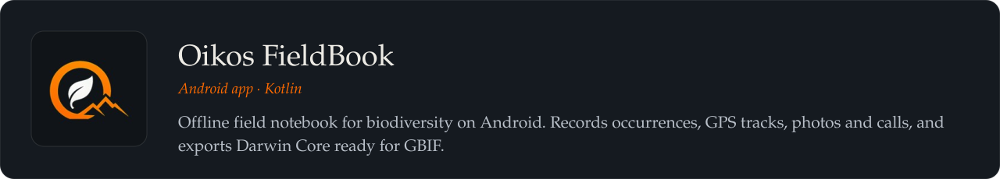
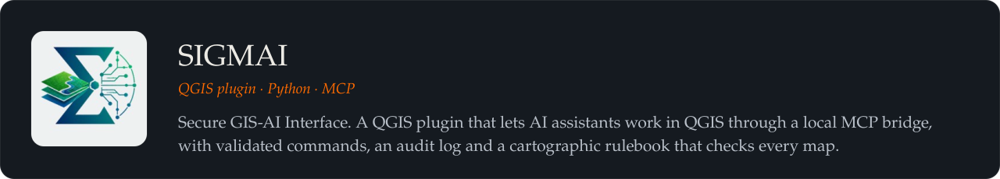
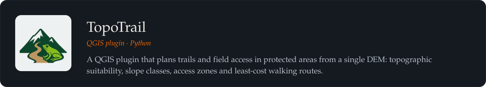
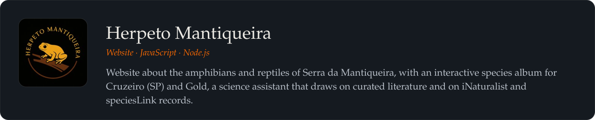

<picture><source media="(max-width: 1011px)" srcset="assets/banner-mobile.svg"></picture>

  
  
  
  
  

## About

- **Background** — Biologist · MSc student in Biodiversity in Protected Areas at the Rio de Janeiro Botanical Garden Research Institute (JBRJ)
- **Research** — frogs, reptiles and ecology in the Atlantic Forest of Serra da Mantiqueira, Brazil
- **Builds** — open tools that take biodiversity data from the field to the map and on to GBIF
- **Open to** — collaborations in herpetology, biodiversity informatics and GIS

## Projects

<a href="https://github.com/LuanCortesM/oikos-fieldbook"><picture><source media="(max-width: 1011px)" srcset="assets/card-oikos-fieldbook-mobile.svg"></picture></a>

[Code](https://github.com/LuanCortesM/oikos-fieldbook) · [Google Play](https://play.google.com/store/apps/details?id=com.oikos.fieldbook) · DOI [10.5281/zenodo.20526746](https://doi.org/10.5281/zenodo.20526746)

<a href="https://github.com/LuanCortesM/SIGMAI"><picture><source media="(max-width: 1011px)" srcset="assets/card-sigmai-mobile.svg"></picture></a>

[Code](https://github.com/LuanCortesM/SIGMAI) · [QGIS plugin](https://plugins.qgis.org/plugins/sigmai/) · DOI [10.5281/zenodo.20389286](https://doi.org/10.5281/zenodo.20389286)

<a href="https://github.com/LuanCortesM/Topotrail"><picture><source media="(max-width: 1011px)" srcset="assets/card-topotrail-mobile.svg"></picture></a>

[Code](https://github.com/LuanCortesM/Topotrail) · [QGIS plugin](https://plugins.qgis.org/plugins/TopoTrail/) · DOI [10.5281/zenodo.20295565](https://doi.org/10.5281/zenodo.20295565)

<a href="https://github.com/LuanCortesM/Herpeto-Mantiqueira"><picture><source media="(max-width: 1011px)" srcset="assets/card-herpeto-mantiqueira-mobile.svg"></picture></a>

[Code](https://github.com/LuanCortesM/Herpeto-Mantiqueira) · [Instagram @herpetomantiqueira](https://www.instagram.com/herpetomantiqueira/)

## Toolbox

- **Android** — Kotlin · Jetpack Compose · Android Studio · Gradle · SQLite
- **GIS and data** — QGIS · Python · Darwin Core · GBIF · Model Context Protocol
- **Web** — JavaScript · Node.js · HTML · CSS
- **Version control** — Git · GitHub

Drawings by the author: the hiker and the outline of Pico do Itaguaré, Serra da Mantiqueira.

